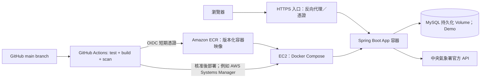

# 部署規劃｜Docker → AWS EC2 → GitHub Actions CI/CD

**狀態**：規劃文件，**尚未新增 Dockerfile、Compose、EC2 或 Workflow**。這份路線圖以目前單店、單一 Spring Boot 執行個體 + MySQL 為起點，先求穩定可重現部署，再增加自動化。

## 目標架構（未來，不是現有系統）

**正式營運建議**：MySQL 可逐步移至 RDS（有獨立資料備份、可用性與網路隔離）；作品集 Demo 先以 Compose app + MySQL 在同台 EC2 運行可以，但需真實備份／還原演練，不能把「容器重啟」當作備份。

## Phase 0｜部署前 Code Review Gate（最優先）

- [ ] 修補／用整合測試確認**採購到貨與銷售併發**、**商品庫存編輯覆寫**的風險。
- [ ] 建 `.gitignore`：`.env`、`.env.*`（保留不含秘密的 `.env.example`）、`target/`、`uploads/`、IDE 暫存檔、日誌、備份檔。
- [ ] 檢查 Git 歷史是否已含 Secret；若有洩漏立即輪換，刪除檔案不等於移除歷史。
- [ ] 拆出 `application-prod.properties`（或 YAML）：`spring.jpa.show-sql=false`，設定正確時區、DB URL／安全連線、Log level、Session Cookie Secure=true。
- [ ] CWA HTTP Client 增加明確連線與讀取 timeout；視需要加入有限重試／快取。
- [ ] 建立健康端點；避免向公網洩漏 DB／設定詳情。
- [ ] 完成 Maven 自動化測試、MySQL Migration 整合測試、核心併發測試。

## Phase 1｜本機 Docker

- [ ] 建多階段 `Dockerfile`：Maven/JDK 21 建置 Spring Boot JAR → 精簡 JRE 21 執行映像，使用**非 root** 使用者。
- [ ] 建 `.dockerignore` 排除 `target`、`.env`、`.git`、`uploads`、文件暫存。
- [ ] 建 `compose.yaml`：`app` + `mysql`，MySQL 使用命名 volume、健康檢查，應用程式等 DB 可用後啟動；**不要**以為 `depends_on` 保證 DB migration 絕不競爭。
- [ ] 容器中的 JDBC Host 改 `mysql`（Compose 服務名稱），不要用 `localhost`，示例：`jdbc:mysql://mysql:3306/weather_order_assistant_db?...`。
- [ ] Session Cookie：本機 HTTP 可用 `SESSION_COOKIE_SECURE=false`；正式 HTTPS 一定要 true。
- [ ] JVM 時區／主機時區統一：`Asia/Taipei`；比對銷售時間、退貨期限與採購跨日政策。
- [ ] 確認**容器重建不刪資料**、資料庫 schema 由 Flyway 升級、備份可復原。

## Phase 2｜GitHub Actions CI

- [ ] 在 `pull_request`／`push` 跑 `./mvnw -B clean verify`，並使用 JDK 21。
- [ ] 引入 Testcontainers MySQL 或 CI 服務資料庫，檢查 Flyway V001–V011 fresh install + Hibernate `validate`。
- [ ] 加入程式格式檢查、依賴掃描／容器映像安全掃描；不要把 Key 放進 Workflow YAML。
- [ ] `GITHUB_TOKEN` 預設設 `permissions: contents: read`，僅真正需要的 job 額外加權限。
- [ ] CI 成功後才建 Docker Image，標籤以**Git commit SHA**（可追溯且容易回滾）；不要只用 `latest`。

## Phase 3｜部署單台 AWS EC2

- [ ] 選定 AWS Region、EC2 instance、EBS 空間、網域／DNS 與預算警示。
- [ ] Security Group 原則：公開 443（與必要 80 重導），**不要公開 3306 或 Java 8080**；遠端管理優先使用 AWS Systems Manager Session Manager。
- [ ] 安裝 Docker Engine／Compose；以 systemd 或 Compose restart policy 管理開機自動恢復。
- [ ] 前方加 TLS 入口（Nginx／Caddy 或合適的 AWS Load Balancer）；設定反向代理的 forwarded headers，再驗證 HTTPS Cookie 和登入流程。
- [ ] 建定期 MySQL 備份＋異地或獨立儲存，定期測試還原；檢查磁碟、記憶體、容器與應用程式日誌。
- [ ] DB 使用最小權限帳號；初始管理員密碼不可永久保留在 `.env`。

## Phase 4｜GitHub Actions CD（GitHub → ECR → EC2）

1. 建 ECR 私有 Repository，設定映像掃描及保留策略。
2. 在 AWS IAM 將 GitHub 設為 OIDC Provider，建立**只允許指定 repo、branch 或 environment** 假設的最小權限 IAM Role。
3. Actions 使用 `aws-actions/configure-aws-credentials` 以 OIDC 取得短期憑證，推送帶 SHA tag 的 Image 到 ECR。
4. 由核准後的 deploy job 透過**AWS Systems Manager Run Command（建議）**或嚴格控管的遠端部署方法，在 EC2 執行 `docker compose pull && docker compose up -d`。
5. 執行部署後健康檢查與登入 smoke test；失敗時切回**上一個可用 SHA image**。GitHub Environments 設置必要的部署核准。
6. CI／CD 只放非秘密設定；DB Password、CWA API Key 等優先由 AWS Secrets Manager／SSM Parameter Store 或受保護的主機環境注入，不內建進 Docker image。

## Phase 5｜發布驗收

- [ ] 清空 DB 首次啟動 9 表／11 migration 成功，重啟不重複 migration。
- [ ] 登入後查詢商品、銷售、天氣、建草稿、送出、到貨、退貨無回歸。
- [ ] 兩個請求同時確認到貨／銷售／編輯商品，最終庫存正確。
- [ ] 外部中央氣象署逾時或返回不完整資料時，整站仍可正常操作。
- [ ] MySQL 容器重建／EC2 重啟不遺失資料，備份可復原。
- [ ] HTTPS 下 Cookie Secure、HttpOnly、SameSite 與 CSRF 正常；登出及改密碼 Session 失效。
- [ ] CI 紅燈不部署；CD 失敗自動或手動回滾；舊版映像可定位。

## 可直接參考的官方文件

- GitHub：OIDC with AWS — https://docs.github.com/en/actions/how-tos/secure-your-work/security-harden-deployments/oidc-in-aws
- GitHub：Secure use of Actions — https://docs.github.com/en/actions/reference/security/secure-use
- AWS IAM：GitHub OIDC role trust 限定來源 — https://docs.aws.amazon.com/IAM/latest/UserGuide/id_roles_create_for-idp_oidc.html
- AWS 官方 GitHub Action：configure-aws-credentials — https://github.com/aws-actions/configure-aws-credentials
- AWS EC2 Infrastructure security — https://docs.aws.amazon.com/AWSEC2/latest/UserGuide/infrastructure-security.html

> 這些 AWS/GitHub 事項屬於**外部最佳實務及部署提案**，不是本專案現在已實作的程式行為。
