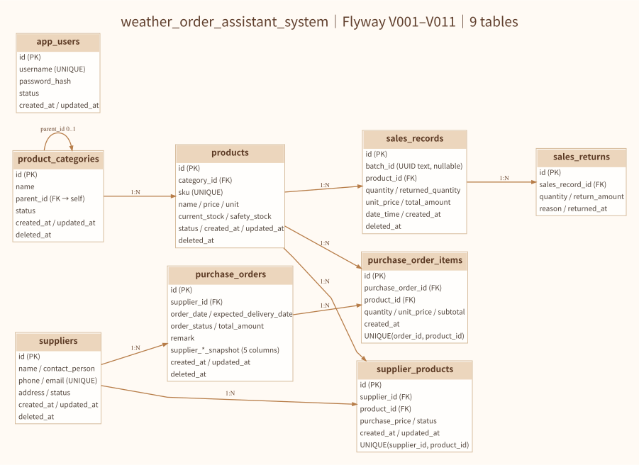
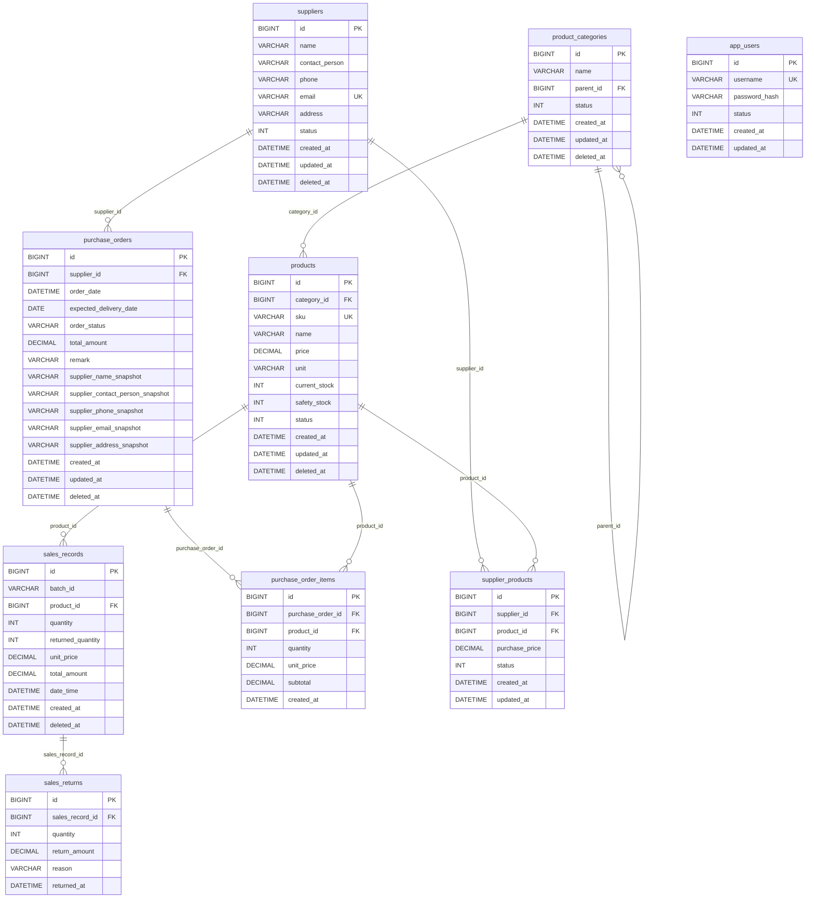

# ER Diagram｜實際資料表結構

來源：`src/main/resources/db/migration/V001`～`V011`；圖中共 **9 張實體表**，不是最初六張表的舊版設計。

> SVG 可放大查看；亦提供 [`er-diagram.png`](diagrams/er-diagram.png) 和可重新生成的 [`er-diagram.dot`](diagrams/er-diagram.dot)。

## 實體關係與特別約束

| 資料表 | 用途 | 重要約束／政策 |
|---|---|---|
| `product_categories` | 商品兩層分類 | `parent_id` 自關聯，**最多兩層由 Service 檢查**，非資料庫 CHECK |
| `products` | 商品、價格、庫存 | `sku` 唯一；`category_id` 外鍵；`current_stock` 非負由 Request／Service 檢查，Migration 未設 CHECK |
| `suppliers` | 供應商資料 | `email` 唯一（可為 NULL）；停用與軟刪除不刪歷史採購資料 |
| `supplier_products` | 供應商供貨與採購單價 | `(supplier_id, product_id)` 唯一，同商品可有多家供應商 |
| `sales_records` | 逐商品銷售資料 | V011 的 `batch_id` 可 NULL；同批商品用相同 UUID 文字，**不是外鍵也不是主檔** |
| `sales_returns` | 多次部分退貨 | 透過 `sales_record_id` 對原始銷售明細；`returned_quantity <= quantity` 在銷售表 CHECK |
| `purchase_orders` | 訂貨主檔 | 狀態 `DRAFT/SUBMITTED/RECEIVED/CANCELLED` 是 Service 規則；V007 增供應商快照欄位 |
| `purchase_order_items` | 訂貨明細 | `(purchase_order_id, product_id)` 唯一，避免同張採購單重複商品 |
| `app_users` | 單店登入帳號 | `username` 唯一；`password_hash` 只存 BCrypt 雜湊；目前無角色、店別外鍵 |

### 非資料庫實體

氣象預報（`WeatherForecastResponse`、`WeatherDailyFactorResponse`）是外部 API 的解析與計算結果，**沒有** `weather_forecasts` 或 `weather_records` 資料表。本版展示天氣使用即時查詢，不在 MySQL 留存預報表。

### 已執行的 Migration

- V001–V006：原始六表
- V007：採購單供應商快照（ALTER）
- V008：銷售退貨明細 + sales_records.returned_quantity
- V009：供貨關聯
- V010：後台登入帳號
- V011：sales_records.batch_id

> 注意：V005/V006 有既有資料庫 checksum 歷史。**已執行的 SQL 不因文件更新而修改**；若要變動 schema，使用下一個 Flyway Migration。
