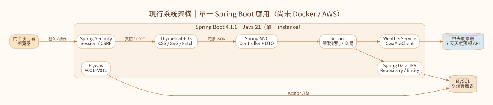
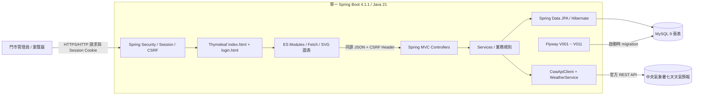

# 系統架構圖｜現有版本

本圖描述**現行程式**，未把尚未實作的 Docker、AWS EC2、ECR 或 GitHub Actions 假裝成既有架構。

亦提供 [`PNG`](diagrams/system-architecture.png)、[`Graphviz DOT`](diagrams/system-architecture.dot)。

## 模組分工

| 元件 | 目前職責 | 主要程式位置 |
|---|---|---|
| 頁面與導航 | `/home` 等固定路由；登入後共用後台模板 | `controller/FrontendRouteController`、`templates/index.html`、`static/js/router.js` |
| 安全 | Form Login、CSRF、防 Session fixation、單一登入數量限制 | `config/SecurityConfig.java`、`service/AccountService.java` |
| 商品／分類／供應商 | 主資料、狀態、供貨關係 | `Product*`、`ProductCategory*`、`Supplier*`、`SupplierProduct*` |
| 銷售／退貨 | 多商品 batch、扣庫存、退貨歷史與回補庫存 | `SalesRecordService`、`SalesReturnRepository` |
| 採購 | 建草稿、送出、取消、到貨入庫與供應商快照 | `PurchaseOrderService`、`PurchaseOrderBatchService` |
| 天氣與訂貨 | 呼叫 CWA、解析資料、七天倍率及商品建議 | `CwaApiClient`、`WeatherService`、`WeatherFactorCalculator`、`OrderRecommendationService` |
| 資料持久化 | JPA Entity、Repository、Flyway Migration | `entity/`、`repository/`、`db/migration/` |

## 主要資料流

1. 登入後瀏覽器取得 Thymeleaf 模板與 CSRF Token；前端 Fetch 同源 `/api/**`，Server 檢查 Session 和 CSRF。
2. 商品銷售：`POST /api/sales-records/batch` → 單一交易 → 按商品 ID 鎖定並扣庫存 → 每項留一筆 `sales_records`。
3. 部分退貨：鎖商品與銷售紀錄 → `sales_returns` 寫入退款與日期 → 回補庫存。
4. 訂貨建議：讀啟用商品、歷史淨銷量和 `SUBMITTED` 未到貨 → 同一次查詢共用中央氣象署資料 → 回傳一般量與天氣量及每日倍率。
5. 採購草稿：使用者選擇商品與供貨商 → 依供應商分組建立 DRAFT → 送出 → 確認到貨時增加庫存。

## 現有部署假設與未實作內容

- 目前使用**單個應用程式實例**；`SessionRegistryImpl` 為本機記憶體，**不能直接視為多容器共享 Session**。
- `spring.config.import=optional:file:.env[.properties]` 假設工作目錄能讀 `.env`；正式容器應設計明確的環境變數或 Secret 注入。
- MySQL 是持久化來源；天氣預報為外部資料，不存於獨立預報表。
- **未實作**：Dockerfile、`compose.yaml`、EC2、ECR、CI/CD、容器健康檢查、正式 HTTPS 入口；這些列在 [部署規劃](DEPLOYMENT_ROADMAP.md)。
